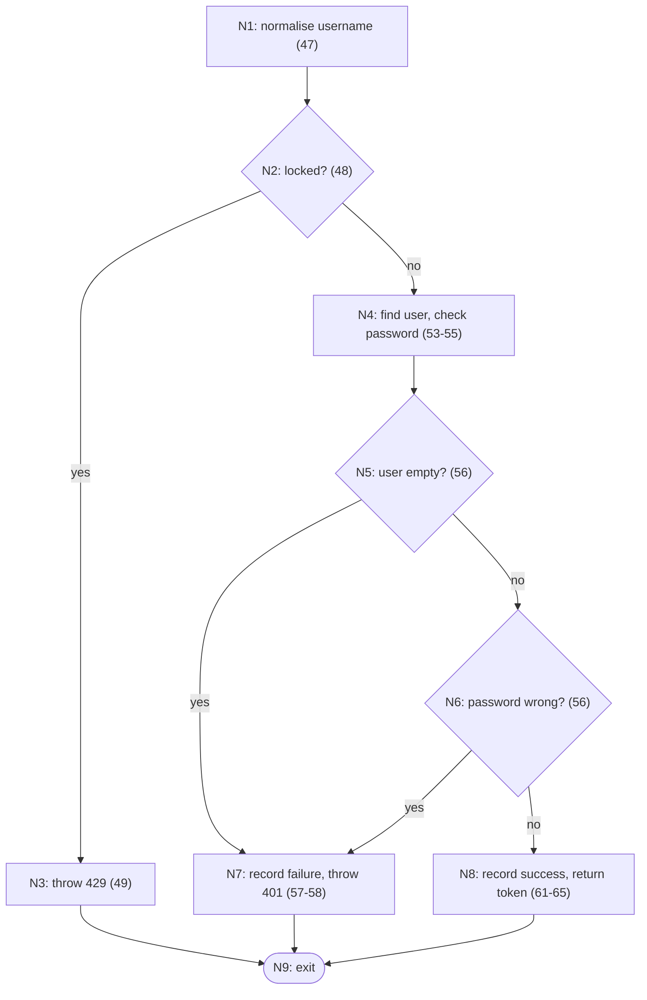

# Cyclomatic Complexity Report — Learnify Student Management System

**Tool:** [lizard](https://github.com/terryyin/lizard) 1.17.13 (supports Java and TypeScript) · **Date:** 2026-11-03
**Raw output:** `docs/test-evidence/lizard-full.txt` (every function) and `lizard-warnings.txt` (threshold check)

Cyclomatic complexity (CCN) counts the independent paths through a function: **CCN = number of decision points + 1** (`if`, loops, `case`, `&&`, `||`, `?:`, `catch`). It is also the minimum number of test cases needed to run every independent path.

Usual interpretation: 1–10 simple and low risk · 11–20 moderate · 21–50 complex, high risk · > 50 untestable.

## 1. Whole-project results

```
python -m lizard server/src/main/java client/src -l java -l typescript
```

| Total NLOC | Functions | Average CCN | Max CCN | Functions over the warning threshold (CCN > 15) |
|---|---|---|---|---|
| 1894 | 313 | **1.4** | **10** | **0** |

| CCN range | Functions | Share |
|---|---|---|
| 1 | 271 | 86.6 % |
| 2–4 | 32 | 10.2 % |
| 5–7 | 7 | 2.2 % |
| 8–10 | 3 | 1.0 % |
| > 10 | 0 | 0 % |

### Most complex functions
| CCN | NLOC | Function | File |
|---|---|---|---|
| 10 | 11 | `validateStudent` | `client/src/utils/validation.ts:10` |
| 9 | 35 | `AnalyticsService.generateInsights` | `server/.../service/AnalyticsService.java:198` |
| 8 | 36 | `DemoDataSeeder.run` | `server/.../config/DemoDataSeeder.java:55` |
| 6 | 9 | `validateSubject` | `client/src/utils/validation.ts:22` |
| 5 | 14 | `getSession` | `client/src/auth/session.ts:19` |
| 5 | 14 | `SubjectService.deleteSubject` | `server/.../service/SubjectService.java:76` |
| 5 | 12 | `LoginAttemptService.recordFailure` | `server/.../security/LoginAttemptService.java:46` |
| 5 | 11 | `StudentController.getAllStudents` | `server/.../controller/StudentController.java:30` |
| 4 | 20 | `MarksService.addOrUpdateMarks` | `server/.../service/MarksService.java:39` |
| 4 | 19 | `AuthController.login` | `server/.../controller/AuthController.java:46` |

**Conclusion:** every function is in the low-risk band (≤ 10). The highest, `validateStudent` (10), is a flat list of independent field checks; each check is covered by a boundary test (FE-STU-B-01..03, FE-STU-N-01).

## 2. Detailed analysis: `AuthController.login` (security-critical)

```java
46  public ResponseEntity<LoginResponse> login(@Valid @RequestBody LoginRequest request) {
47      String username = request.username().trim().toLowerCase(Locale.ROOT);
48      if (loginAttempts.isLocked(username)) {                         // D1
49          throw new ApiException(TOO_MANY_REQUESTS, "...");
51      }
53      Optional<User> user = userRepository.findByUsername(username);
54      boolean matches = passwordEncoder.matches(request.password(),
55              user.map(User::getPasswordHash).orElse(dummyHash));
56      if (user.isEmpty() || !matches) {                                // D2 (user.isEmpty) || D3 (!matches)
57          loginAttempts.recordFailure(username);
58          throw new ApiException(UNAUTHORIZED, BAD_CREDENTIALS);
59      }
61      loginAttempts.recordSuccess(username);
62-65   ... generate token, return 200
66  }
```

### Control-flow graph


### Calculation
| Method | Working | CCN |
|---|---|---|
| Edges and nodes | E = 11 (N1→N2, N2→N3, N2→N4, N4→N5, N5→N7, N5→N6, N6→N7, N6→N8, N3→N9, N7→N9, N8→N9), N = 9. V(G) = E − N + 2 = 11 − 9 + 2 | **4** |
| Decision points | D1 + D2 + D3 = 3 → 3 + 1 | **4** |
| Regions of the graph | 3 enclosed regions + 1 outer region | **4** |
| lizard | reported | **4** ✅ matches |

### Basis paths and the tests that run them
| Path | Route | Meaning | Test case | Executed |
|---|---|---|---|---|
| P1 | N1→N2→N3→N9 | Account locked → 429 | AUTH-B-02 `accountIsLockedAfterFiveFailures` | ✅ |
| P2 | N1→N2→N4→N5→N7→N9 | Unknown user → 401 | AUTH-N-01 `wrongPasswordAndUnknownUserGiveSameMessage` (`nobody`) | ✅ |
| P3 | N1→N2→N4→N5→N6→N7→N9 | Known user, wrong password → 401 | AUTH-N-01 (`admin/wrong`) | ✅ |
| P4 | N1→N2→N4→N5→N6→N8→N9 | Correct credentials → 200 + token | AUTH-P-01 `correctCredentialsReturnValidToken` | ✅ |

All 4 basis paths are tested. JaCoCo confirms **6/6 branches (100 %)** covered in `AuthController`.
A hidden branch on line 55 (`orElse(dummyHash)`) is deliberate: for unknown users the server still runs a BCrypt check, so both failures take similar time and attackers cannot learn which usernames exist.

## 3. Module-level analysis: `AnalyticsService.generateInsights` (CCN 9, the highest in the backend)

| # | Decision | Line purpose |
|---|---|---|
| 1 | `if (!subjectAverages.isEmpty())` | subject insights only when data exists |
| 2 | `if (lowest != null)` | weakest subject message |
| 3 | `if (!belowThreshold.isEmpty())` | at-risk students message |
| 4 | `if (summary.getTopPerformerName() != null)` | top performer message |
| 5 | `if (summary.getClassAverage() > 0)` | class level message |
| 6 | `?: classAverage >= 70` | "excellent" |
| 7 | `?: classAverage >= 50` | "average" vs "below average" |
| 8 | `if (summary.getPassPercentage() > 0)` | pass-rate message |

CCN = 8 + 1 = **9**. The decisions are independent, sequential `if`s (no nesting), so the function stays readable despite its score. The tests cover both "no data" (`emptyDatabaseGivesZeroSummaryWithoutErrors`: every `if` false) and "full data" (`summaryCombinesAllFigures`: every `if` true). JaCoCo reports `AnalyticsService` at 100 % lines and 80 % branches (24/30). The class-level bands not reached by these data sets are ≥ 70 ("excellent") and < 50 ("below average"); the exact missed branches are marked in yellow and red in the JaCoCo HTML report.

**Recommendation (optional):** if more insights are added, split them into small rule methods (`List<InsightRule>`) to keep each one testable and below CCN 5.

## 4. Complexity of code changed by the defect fixes
After the DEF-02 fix, `LoginAttemptService.recordFailure` measures CCN **5** (lizard was not run before the fix, so no before/after comparison is claimed). That is still low; its paths are exercised by AUTH-B-01..06, and JaCoCo reports 13/14 branches covered in the class.
